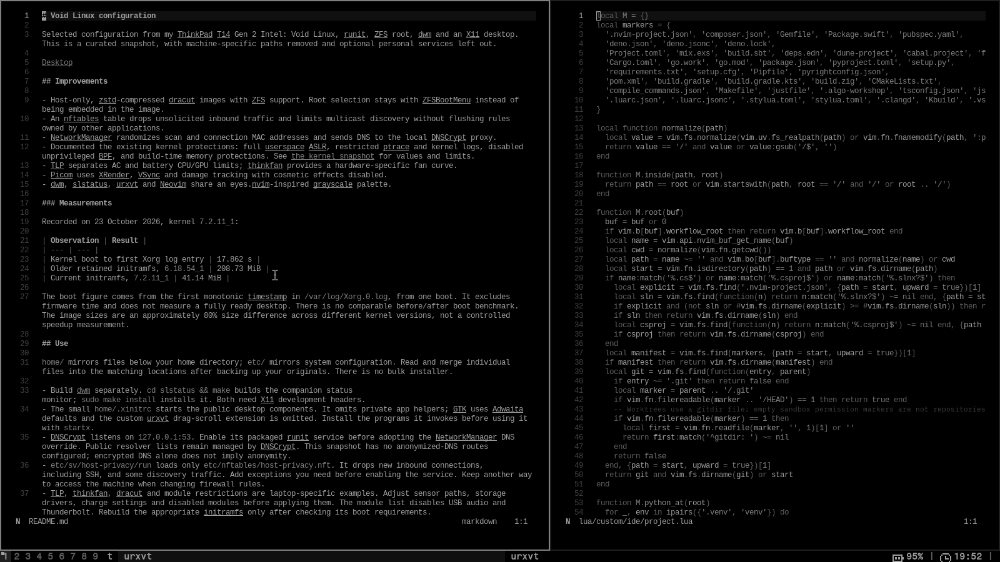

# Void Linux configuration

Selected configuration from my ThinkPad T14 Gen 2 Intel: Void Linux, runit, ZFS root, dwm and an X11 desktop. This is a curated snapshot, with machine-specific paths removed and optional personal services left out.

## Improvements

- Host-only, zstd-compressed dracut images with ZFS support. Root selection stays with ZFSBootMenu instead of being embedded in the image.
- An nftables table drops unsolicited inbound traffic and limits multicast discovery without flushing rules owned by other applications.
- NetworkManager randomizes scan and connection MAC addresses and sends DNS to the local DNSCrypt proxy.
- Documented the existing kernel protections: full userspace ASLR, restricted ptrace and kernel logs, disabled unprivileged BPF, and build-time memory protections. See [the kernel snapshot](KERNEL.md) for values and limits.
- TLP separates AC and battery CPU/GPU limits; thinkfan provides a hardware-specific fan curve.
- dnscrypt-proxy uses four large no-log, unfiltered resolvers instead of every matching server; cold lookups are about 2.5 times faster.
- LibreWolf keeps its privacy defaults but resolves and connects ahead of the click (DNS prefetch through the local resolver, speculative connections, TLS 0-RTT) through `home/.librewolf/librewolf.overrides.cfg`.
- Picom uses the GLX backend, VSync and damage tracking with cosmetic effects disabled, and runs with real-time scheduling through rtkit (`--realtime`).
- `thaw` watches for freezes. It logs X server stalls, kills a compositor that may hold a server grab, and restarts one that stopped painting. A probe hidden by the screen saver, a locker or a window above it is not blamed on the compositor.
- dwm, slstatus, urxvt and Neovim share an eyes.nvim-inspired grayscale palette.

### Measurements

Recorded on 23 October 2026, kernel `7.2.11_1`:

| Observation | Result |
| --- | --- |
| Kernel boot to first Xorg log entry | 17.862 s |
| Older retained initramfs, `6.18.54_1` | 208.73 MiB |
| Current initramfs, `7.2.11_1` | 41.14 MiB |

Picom, recorded on 26 November 2026 (Intel Iris Xe, modesetting without TearFree, 1920x1080 at 60 Hz). A 1880x1000 window repainted about 50 times a second for 6 s, with the Present completion mode of each composited frame counted on the overlay window:

| Configuration | Frames presented as flips | Copies | Frames late for the vblank, all 8 CPUs busy |
| --- | --- | --- | --- |
| GLX | 100% | 0 | 28 |
| GLX, `--realtime` | 100% | 0 | 17 |

Late frames are picom's own "render did not complete during vblank" debug messages over two runs each. With the XRender backend every frame was also a flip, but its present call blocks picom's event loop until the vblank, so the same count is not available. Under that load Xorg used about 17% less CPU with GLX than with XRender, and picom used more. These are single-session measurements, not a controlled benchmark.

DNS, recorded on 26 November 2026 on a link with about 78 ms round trip to public anycast resolvers. Cold lookups of 20 names not queried before, through a fresh dnscrypt-proxy instance each time:

| Resolver selection | Median | 90th percentile |
| --- | --- | --- |
| Every server matching the filters (458) | 274–357 ms | 603–1359 ms |
| The four `server_names` above | 112–126 ms | 187–350 ms |

Ranges are two name sets, each run on both configurations in swapped order. On the running service, the same change measured 157 ms median for another 20 new names. Results depend on the network and the resolvers' caches.

The boot figure comes from the first monotonic timestamp in `/var/log/Xorg.0.log`, from one boot. It excludes firmware time and does not measure a fully ready desktop. There is no comparable before/after boot benchmark. The image sizes are an approximately 80% size difference across different kernel versions, not a controlled speedup measurement.

## Use

`home/` mirrors files below your home directory; `etc/` mirrors system configuration. Read and merge individual files into the matching locations after backing up your originals. There is no bulk installer.

- Build [dwm](https://github.com/bedeaf/dwm) separately. `cd slstatus && make` builds the companion status monitor; `sudo make install` installs it. `cd thaw && make install` puts `thaw` in `~/.local/bin`; it logs to `~/.local/state/thaw/thaw.log`. All need X11 development headers; thaw also needs the XRes and xcb-screensaver headers.
- The small `home/.xinitrc` starts the public desktop components. It omits private app helpers; GTK uses Adwaita defaults and the custom urxvt drag-scroll extension is omitted. Install the programs it invokes before using it with `startx`.
- `home/.librewolf/librewolf.overrides.cfg` is read by LibreWolf when the profile lives under `~/.librewolf`; profiles in the XDG location read `~/.config/librewolf/librewolf/librewolf.overrides.cfg`. `librewolf.cfg` forces some of these preferences on every start, so `user.js` cannot change them. Remove a line to restore the LibreWolf value; the 0-RTT lines trade replay protection of early data for one round trip.
- `etc/dnscrypt-proxy/dnscrypt-proxy-settings.toml` is a settings excerpt: merge its top-level values into your packaged `dnscrypt-proxy.toml`, before any table headers. Keep the packaged `[sources]` tables and their public signature-verification keys. Do not replace the full configuration with this excerpt. DNSCrypt listens on `127.0.0.1:53`. Enable its packaged runit service before adopting the NetworkManager DNS override. Public resolver lists remain managed by DNSCrypt. This snapshot has no anonymized-DNS routes configured; encrypted DNS alone does not imply anonymity.
- `etc/sv/host-privacy/run` loads only `etc/nftables/host-privacy.nft`. It drops new inbound connections, including SSH, and some discovery traffic. Add exceptions you need before enabling the service. Keep another way to access the machine when changing firewall rules.
- TLP, thinkfan, dracut and module restrictions are laptop-specific examples. Adjust sensor paths, storage drivers, charge settings and disabled modules before applying them. The module list disables USB audio and Thunderbolt. Rebuild the appropriate initramfs only after checking its boot requirements.

No SSH/WireGuard keys, network profiles, browser data, credentials, host IDs or full machine logs are included. Kernel command-line hardening and Anonymized DNS are not claimed because the inspected running setup did not establish them.

## Credits

Inspired by the small, composable tools documented in the [Void Handbook](https://docs.voidlinux.org/) and [suckless](https://suckless.org/). Palette: [eyes.nvim](https://github.com/amedoeyes/eyes.nvim). slstatus is based on [suckless slstatus](https://tools.suckless.org/slstatus/), with its upstream license preserved in `slstatus/LICENSE`.

Related: [dwm](https://github.com/bedeaf/dwm) · [Neovim](https://github.com/bedeaf/nvim).
